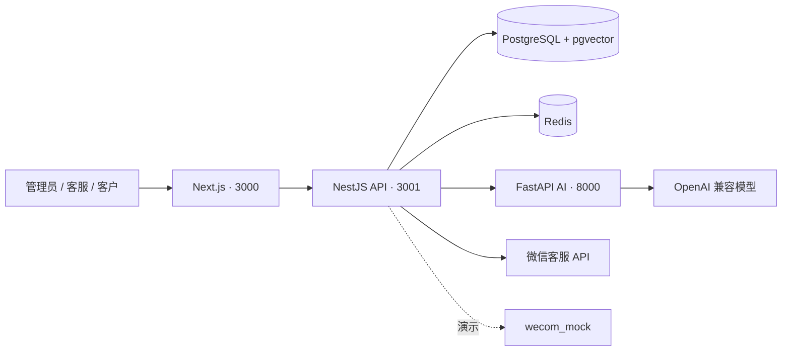

# AI 客服系统（微信客服版）

面向**单一企业**部署的微信客服 AI 工作区：客户向微信客服账号发消息，系统检索项目知识库、生成回复，并由同一客服账号发出。

> 不是多租户自助 SaaS。回复身份是**微信客服账号**，不是员工个人号或群机器人。  
> 一个企业可接入多个客服账号，共用**唯一项目知识库**。

---

## 目录

- [当前状态](#当前状态)
- [核心能力](#核心能力)
- [技术架构](#技术架构)
- [本地演示（推荐）](#本地演示推荐)
- [服务地址](#服务地址)
- [配置说明](#配置说明)
- [本地分进程开发](#本地分进程开发)
- [业务流程要点](#业务流程要点)
- [常见问题](#常见问题)
- [开发命令](#开发命令)

---

## 当前状态

| 能力 | 状态 |
| --- | --- |
| 工作台 / 知识库 / AI 草稿 | 可本地演示 |
| 微信客服 API（回调、sync、发送） | 代码已接入，待真实企业验收 |
| 自动发送（开关 + **时段**） | 可用；真实发送需账号验收 |
| 知识试检索 / 索引健康 | 已提供 |
| `wecom_mock` | 可用于无企微账号的演示 |

真实 Corp 凭证、公网 HTTPS 回调、多账号隔离尚未在目标企业验收；构建通过 ≠ 平台联调通过。

---

## 核心能力

| 模块 | 能力 | 说明 |
| --- | --- | --- |
| 客服工作台 | 会话、AI/人工接管、发送策略 | 演示流程可用 |
| 知识库 | 导入审核、向量检索、引用、缺口、试检索 | 单项目知识库 |
| AI 回复 | OpenAI 兼容模型、风险拦截、无依据转人工 | 需配置可用模型 |
| 自动发送 | 工作区开关、**北京时间时段**、会话策略门禁 | 时段外只留草稿 |
| 微信客服 | 多账号、加密回调、游标同步、48h/5 条限制 | 待真实验收 |
| 运维 | PostgreSQL、Redis、审计、请求 ID | 生产演练仍需完成 |

---

## 技术架构



| 路径 | 内容 |
| --- | --- |
| `apps/web` | 管理端、客服工作台、客户演示门户 |
| `services/api` | 业务 API、认证、知识库、渠道 |
| `services/ai` | 内部 AI 回复服务 |
| `docker-compose.yml` | 一键演示 / 开发编排 |

**说明（简）：** Redis 只做实时事件与限流，不存业务数据。检索使用 pgvector cosine；不同 embedding 维度下暂用精确排序（HNSW 待维度统一后启用）。

---

## 本地演示（推荐）

无需企业微信账号。在项目根目录：

```powershell
if (!(Test-Path .env)) { Copy-Item .env.example .env }
docker compose up --build -d
```

打开：**http://localhost:3000/login**

```powershell
docker compose ps
docker compose logs -f api ai web
docker compose down          # 停止（保留数据卷）
# docker compose down -v   # 会删除本地库，慎用
```

已有 `.env` 时不要用示例覆盖密钥。演示数据仅在**空库**时初始化，普通重启不会重置业务数据。

### 演示账号

密码均为 `demo-password`（仅本地，勿用于生产）。

| 账号 | 角色 | 用途 |
| --- | --- | --- |
| `agent@demo.aikefu.local` | 管理员 | 全功能 |
| `kefu@demo.aikefu.local` | 客服 | 工作台 / 知识提交 |
| `customer@demo.aikefu.local` | 客户 | 客户门户 |
| `suwan@…` / `helei@…` / `mating@…` | 客户 | 独立演示会话 |

建议用两个浏览器配置文件分别登录客服与客户，走通「消息 → AI → 人工 → 回复」。

### 生产 Compose（单机）

复制 [`.env.production.example`](.env.production.example) → `.env.production`，填入强密钥与域名后：

```powershell
docker compose --env-file .env.production up --build -d
```

要求：`NODE_ENV=production`、`ENABLE_DEMO_SEED=false`、前方 HTTPS 反向代理。生产禁止模拟企微与 hash embedding 降级。

---

## 服务地址

| 服务 | 地址 |
| --- | --- |
| Web | http://localhost:3000 |
| API 存活 | http://localhost:3001/health |
| API 就绪 | http://localhost:3001/ready |
| AI | http://localhost:8000/health |
| PostgreSQL | `localhost:5433` |
| Redis | `localhost:6379` |

---

## 配置说明

模板：根目录 [`.env.example`](.env.example)，以及 `apps/web`、`services/api` 下的示例文件。

| 变量 | 用途 |
| --- | --- |
| `POSTGRES_*` | 数据库账号 |
| `AUTH_SECRET` | JWT 签名（生产 ≥ 32 字符随机） |
| `AI_KEY_SECRET` | 模型 Key 加密（可回退 `AUTH_SECRET`） |
| `AI_SERVICE_TOKEN` | API ↔ AI 内部认证（两端必须一致） |
| `ENABLE_DEMO_SEED` | 演示种子；**生产必须 `false`** |
| `BOOTSTRAP_ADMIN_*` | 空库初始化管理员 |
| `REDIS_URL` | Redis |
| `NEXT_PUBLIC_API_BASE_URL` | 浏览器访问 API 的地址 |
| `EMBEDDING_*` | 向量接口（DeepSeek 聊天不含 embeddings，需另配） |

Compose 启动 API 前会执行 `prisma migrate deploy`。切换 embedding 模型后，请重新发布知识文档以重建索引。

---

## 本地分进程开发

需先启动 PostgreSQL（含 pgvector）并完成迁移。

```powershell
# API
cd services/api
npm install
npm run start:dev

# AI
cd services/ai
python -m venv .venv
.venv\Scripts\Activate.ps1
pip install -r requirements.txt
$env:AI_SERVICE_TOKEN="dev-ai-token"
uvicorn app.main:app --reload --port 8000

# Web
cd apps/web
npm install
npm run dev
```

macOS / Linux：`source .venv/bin/activate`，并用 `export AI_SERVICE_TOKEN=dev-ai-token`。

---

## 业务流程要点

1. 客户消息进入会话 → 在项目知识库检索 → 策略 / 风险判断  
2. 有依据且门禁通过 → 可自动发送（受工作区开关与**时段**约束）  
3. 无命中或敏感场景 → 转人工，并记录知识缺口  
4. 发送前再次校验：最新客户消息、开关、策略、微信 48h / 5 条限制  

`wecom_mock` 的「发送成功」仅表示本系统模拟完成。真实发送走 `kf/send_msg`，需企业后台授权与回调验收。

---

## 常见问题

| 现象 | 处理 |
| --- | --- |
| 页面打不开 | `docker compose ps` / `logs web` |
| 登录失败 | 演示密码 `demo-password`；生产空库需 bootstrap 管理员 |
| API 不可用 | `logs api` → `/health` → `/ready` |
| 调不通 AI | 核对两端 `AI_SERVICE_TOKEN` |
| 端口占用 | 调整 `.env` 中 `*_PORT`，并同步 `WEB_ORIGIN` / `NEXT_PUBLIC_API_BASE_URL` |
| 自动回复未发出 | 模型、知识引用、开关、**时段**、会话策略、Redis、48h/5 条 |

排查时记下响应头 `X-Request-ID`。勿在 Issue / 截图中泄露密钥与真实客户资料。

---

## 开发命令

| 目录 | 命令 | 说明 |
| --- | --- | --- |
| `apps/web` | `npm run dev` / `build` | Web |
| `services/api` | `npm run start:dev` / `build` | API |
| `services/api` | `npm run prisma:generate` / `prisma:migrate` | Prisma |
| `services/ai` | `uvicorn app.main:app --reload --port 8000` | AI |
| 根目录 | `scripts/smoke-api.ps1` | API 冒烟（需服务已启动） |

产品与验收长文档如保存在本地 `docs/`，可能不在公开仓库内；本 README 覆盖启动与能力边界即可上手。
