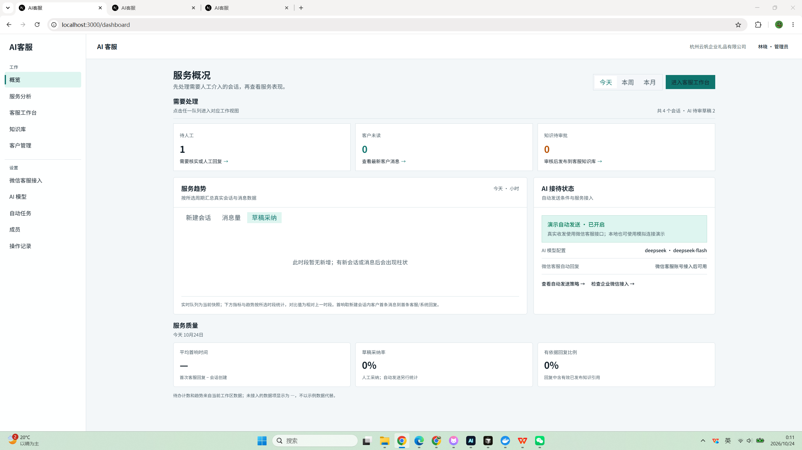
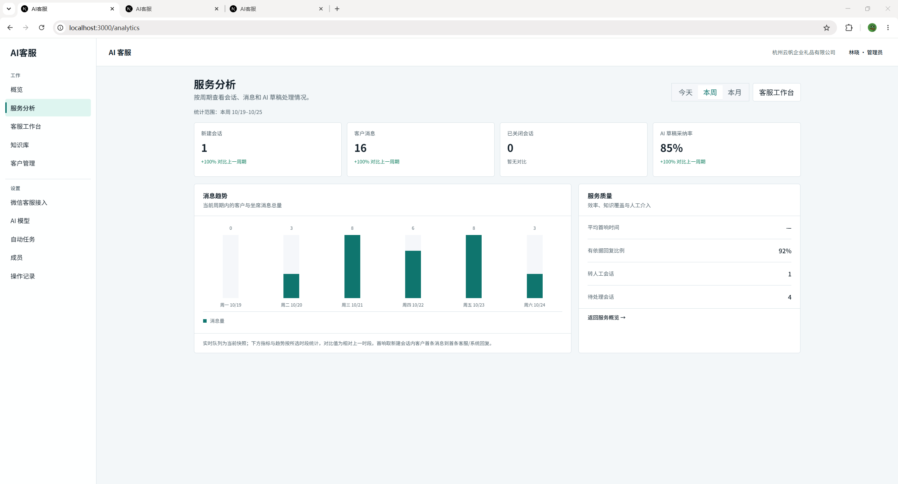
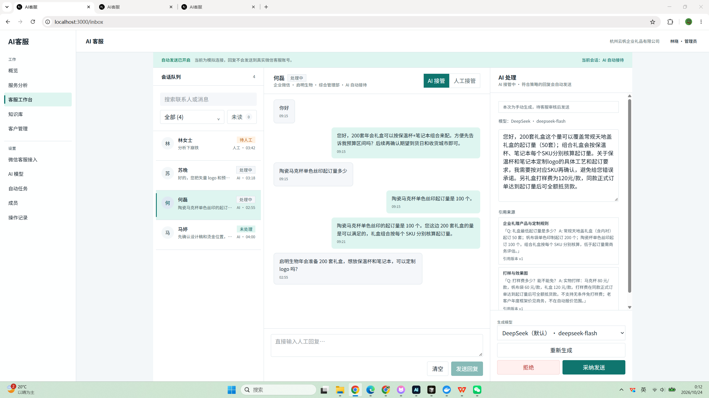
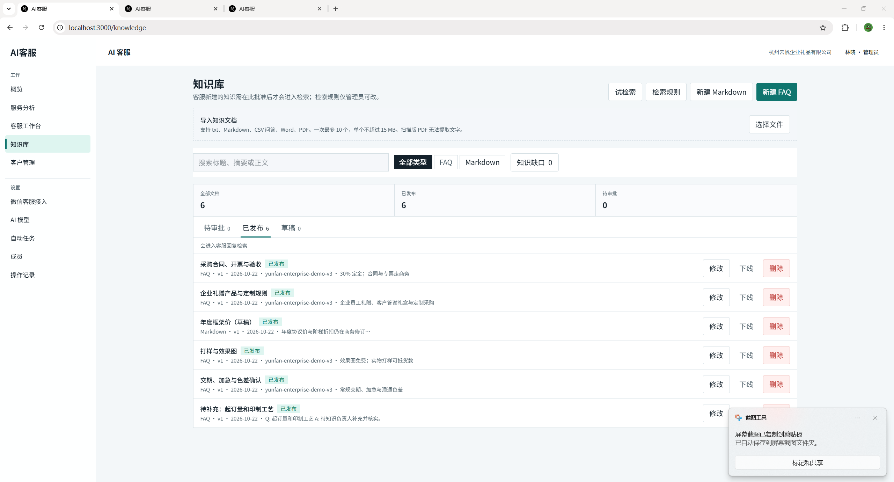
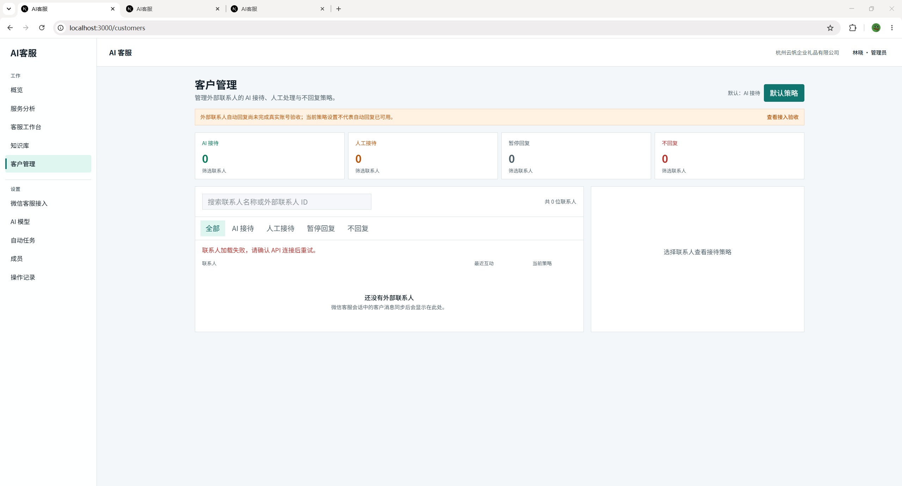
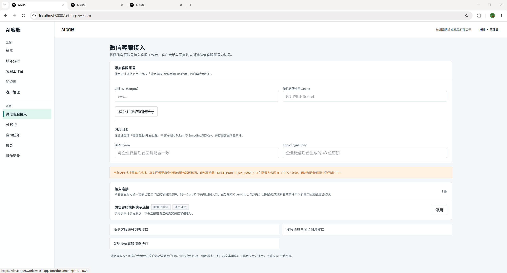
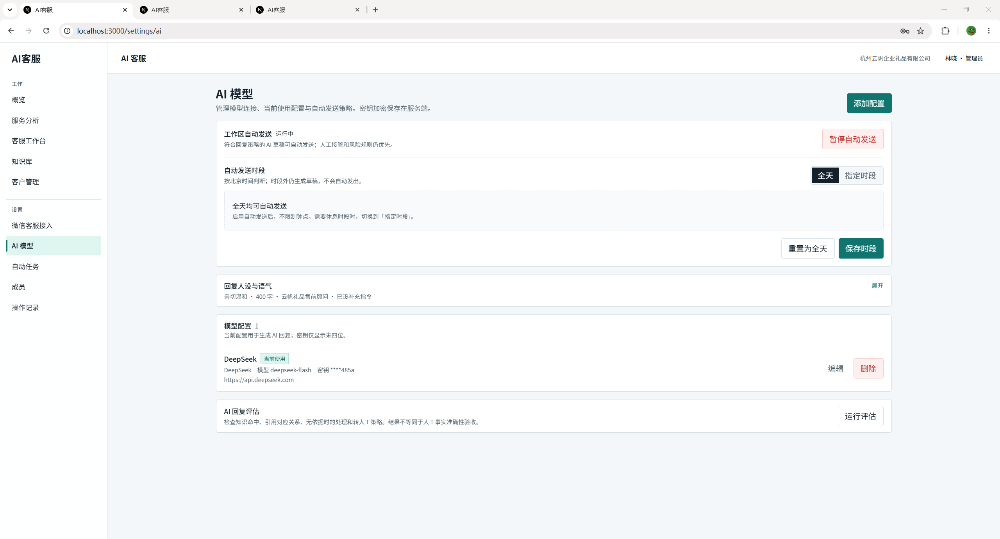
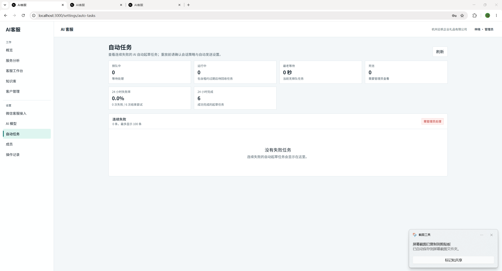
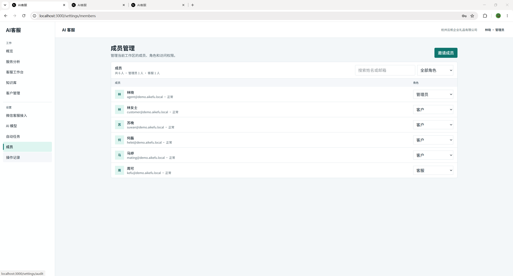
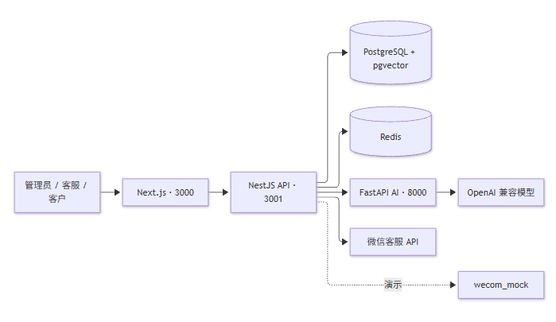

# AI 客服系统（微信客服版）

面向**单一企业**部署的微信客服 AI 工作区：客户向微信客服账号发消息 → 检索项目知识库 → 生成回复 → 由同一客服账号发出。

> **定位：** 不是多租户自助 SaaS。回复身份是**微信客服账号**（非员工个人号 / 群机器人）。  
> 一个企业可接入多个客服账号，共用**唯一项目知识库**。  
> **边界：** 工作台 / 知识库 / `wecom_mock` 可本地演示；真实 Corp 凭证、公网 HTTPS 回调、多账号隔离待企业验收。构建通过 ≠ 平台联调通过。

---

## 目录

- [本地演示](#本地演示)
- [界面预览](#界面预览)
- [能力一览](#能力一览)
- [技术架构](#技术架构)
- [业务流程](#业务流程)
- [配置说明](#配置说明)
- [本地开发](#本地开发)
- [生产 Compose](#生产-compose)
- [常见问题](#常见问题)

---

## 本地演示

无需企业微信账号。在项目根目录：

```bash
# macOS / Linux
[ -f .env ] || cp .env.example .env
docker compose up --build -d
```

```powershell
# Windows PowerShell
if (!(Test-Path .env)) { Copy-Item .env.example .env }
docker compose up --build -d
```

打开 **http://localhost:3000/login**。密码均为 `demo-password`（仅本地，勿用于生产）。

| 账号 | 角色 | 用途 |
| --- | --- | --- |
| `agent@demo.aikefu.local` | 管理员 | 全功能 |
| `kefu@demo.aikefu.local` | 客服 | 工作台 / 知识提交 |
| `customer@demo.aikefu.local` | 客户 | 客户门户 |
| `suwan@demo.aikefu.local` | 客户 | 独立演示会话 |
| `helei@demo.aikefu.local` | 客户 | 独立演示会话 |
| `mating@demo.aikefu.local` | 客户 | 独立演示会话 |

建议用两个浏览器配置文件分别登录客服与客户，走通「消息 → AI → 人工 → 回复」。

| 服务 | 地址 |
| --- | --- |
| Web | http://localhost:3000 |
| API | http://localhost:3001/health · http://localhost:3001/ready |
| AI | http://localhost:8000/health |
| PostgreSQL | `localhost:5433` |
| Redis | `localhost:6379` |

```bash
docker compose ps
docker compose logs -f api ai web
docker compose down          # 停止，保留数据卷
# docker compose down -v   # 删除本地库，慎用
```

已有 `.env` 时不要用示例覆盖密钥。演示数据仅在**空库**时初始化，普通重启不会重置业务数据。

---

## 界面预览

以下为本地演示（`agent@demo.aikefu.local`）各主页面截图，按侧边栏顺序说明。建议先登管理员账号，再按「概览 → 工作台 → 知识库 → AI 模型」走查。

### 1. 服务概况

待办汇总、服务趋势、AI 接待状态与质量指标；可一键进入客服工作台。



### 2. 服务分析

会话 / 消息量、草稿采纳率与消息趋势，便于回看一段时间内的接待表现。



### 3. 客服工作台

会话列表 + 聊天区 + 右侧 AI 草稿。可在 AI / 人工接管间切换；草稿带来源引用，支持重新生成、拒绝或采纳发送。顶部提示「自动发送已开启」时，模拟渠道仍不会发到真实微信账号。



### 4. 知识库

FAQ / Markdown 管理、文档导入、试检索与发布审批。新知识需审批后才可被检索引用。



### 5. 客户管理

按联系人配置 AI 接待、人工接待、暂停或不回复等策略。未完成企微同步时列表可能为空，属预期。



### 6. 微信客服接入

填写 CorpID / Secret、回调 Token 与 EncodingAESKey；本地可用「模拟接入」联调。真实联调需公网 HTTPS 的 `NEXT_PUBLIC_API_BASE_URL`。



### 7. AI 模型

模型连接、工作区自动发送开关与时段、回复人设（可展开编辑）、以及回复评估入口。Key 在服务端加密存储。



### 8. 自动任务

查看 AI 自动起草队列：排队 / 运行中 / 死信与 24h 失败率；连续失败任务可在此排查后重放。



### 9. 成员管理

邀请成员、按角色分配权限。演示账号与上文「本地演示」表格一致（管理员、客服、若干客户）。



---

## 能力一览

| 模块 | 能力 | 状态 |
| --- | --- | --- |
| 客服工作台 | 会话、AI / 人工接管、发送策略 | 可本地演示 |
| 知识库 | 导入审核、向量检索、引用、缺口、试检索、索引健康 | 可本地演示（单项目） |
| AI 回复 | OpenAI 兼容模型、风险拦截、无依据转人工 | 需配置可用模型 |
| 自动发送 | 工作区开关、**北京时间时段**、会话策略门禁 | 可用；时段外只留草稿 |
| 微信客服 | 多账号、加密回调、游标同步、48h / 5 条限制 | 代码已接入，待企业验收 |
| 运维 | PostgreSQL、Redis、审计、请求 ID | 生产演练仍需完成 |

---

## 技术架构



| 路径 | 内容 |
| --- | --- |
| `apps/web` | 管理端、客服工作台、客户演示门户 |
| `services/api` | 业务 API、认证、知识库、渠道 |
| `services/ai` | 内部 AI 回复服务 |
| `docker-compose.yml` | 一键演示 / 开发编排 |

Redis 只做实时事件与限流，不存业务数据。检索使用 pgvector cosine；embedding 维度未统一前暂用精确排序（HNSW 待启用）。

---

## 业务流程

1. 客户消息进入会话 → 项目知识库检索 → 策略 / 风险判断  
2. 有依据且门禁通过 → 可自动发送（受工作区开关与**时段**约束）  
3. 无命中或敏感场景 → 转人工，并记录知识缺口  
4. 发送前再校验：最新客户消息、开关、策略、微信 48h / 5 条限制  

`wecom_mock` 的「发送成功」仅表示本系统模拟完成。真实发送走 `kf/send_msg`，需企业后台授权与回调验收。

---

## 配置说明

模板：[`.env.example`](.env.example)；`apps/web`、`services/api` 下另有示例。Compose 启动 API 前会执行 `prisma migrate deploy`。切换 embedding 模型后，请重新发布知识文档以重建索引。

| 变量 | 用途 |
| --- | --- |
| `POSTGRES_*` | 数据库账号 |
| `AUTH_SECRET` | JWT 签名（生产 ≥ 32 字符随机） |
| `AI_KEY_SECRET` | 模型 Key 加密（可回退 `AUTH_SECRET`） |
| `AI_SERVICE_TOKEN` | API ↔ AI 内部认证（两端必须一致） |
| `ENABLE_DEMO_SEED` | 演示种子；**生产必须 `false`** |
| `BOOTSTRAP_ADMIN_*` | 空库初始化管理员 |
| `REDIS_URL` | Redis |
| `NEXT_PUBLIC_API_BASE_URL` | 浏览器访问 API 的地址 |
| `EMBEDDING_*` | 向量接口（DeepSeek 聊天不含 embeddings，需另配） |

---

## 本地开发

需先启动 PostgreSQL（含 pgvector）并完成迁移。

```powershell
# API  ·  npm run start:dev / build / prisma:generate / prisma:migrate
cd services/api
npm install
npm run start:dev

# AI   ·  uvicorn app.main:app --reload --port 8000
cd services/ai
python -m venv .venv
.venv\Scripts\Activate.ps1            # macOS/Linux: source .venv/bin/activate
pip install -r requirements.txt
$env:AI_SERVICE_TOKEN="dev-ai-token"  # macOS/Linux: export AI_SERVICE_TOKEN=dev-ai-token
uvicorn app.main:app --reload --port 8000

# Web  ·  npm run dev / build
cd apps/web
npm install
npm run dev
```

服务已启动时，根目录可跑 API 冒烟：`scripts/smoke-api.ps1`。

---

## 生产 Compose

复制 [`.env.production.example`](.env.production.example) → `.env.production`，填入强密钥与域名后：

```bash
docker compose --env-file .env.production up --build -d
```

要求：`NODE_ENV=production`、`ENABLE_DEMO_SEED=false`、前方 HTTPS 反向代理。生产禁止模拟企微与 hash embedding 降级。

公开仓库覆盖启动与能力边界；更长的产品 / 验收文档若在本地 `docs/`，可能未入库。

---

## 常见问题

| 现象 | 处理 |
| --- | --- |
| 页面打不开 | `docker compose ps` / `logs web` |
| 登录失败 | 密码 `demo-password`；生产空库需 bootstrap 管理员 |
| API 不可用 | `logs api` → `/health` → `/ready` |
| 调不通 AI | 核对两端 `AI_SERVICE_TOKEN` |
| 端口占用 | 调整 `.env` 中 `*_PORT`，并同步 `WEB_ORIGIN` / `NEXT_PUBLIC_API_BASE_URL` |
| 自动回复未发出 | 模型、知识引用、开关、**时段**、会话策略、Redis、48h / 5 条 |

排查时记下响应头 `X-Request-ID`。勿在 Issue / 截图中泄露密钥与真实客户资料。
