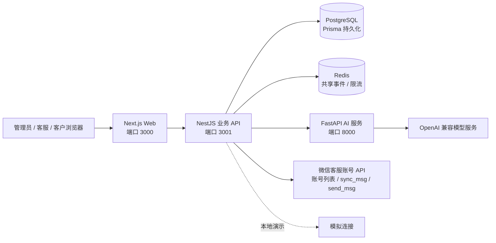

# AI 客服系统（微信客服版）

项目面向一个企业微信企业的微信客服团队：微信客户向微信客服账号发消息，系统读取对应客服会话，并通过同一个微信客服账号回复。一个企业可接入多个微信客服账号；所有账号共用本工作区唯一的项目知识库。管理员和客服成员共用本租户工作区。回复身份是微信客服账号，不是企业微信员工个人账号或企业微信机器人。

> **当前实现状态：** 已补齐微信客服账号配置 UI、账号列表验证、加密回调校验、按回调 `OpenKfId` 将消息路由到账号连接、按独立游标执行 `kf/sync_msg`、工作台真实文本发送和平台 48 小时/5 条回复限制。同一 CorpID 下使用共享回调入口。`wecom_mock` 仍可用于演示。真实企业凭证、公网回调和多账号隔离尚未在目标企业环境验收；构建通过不等于平台联调通过；旧员工私聊连接仅作为历史记录保留。

## 1. 项目介绍

### 核心能力

| 模块 | 能力 | 当前状态 |
| --- | --- | --- |
| 客服工作台 | 会话列表、消息处理、AI/人工接管、发送前策略校验 | 可用演示流程 |
| 知识库 | 单一项目知识库、文档导入与审核发布、向量检索、引用和知识缺口 | 已实现基础能力 |
| AI 回复 | OpenAI 兼容模型配置、回复草稿、风险拦截、无依据转人工 | 需配置可用模型；有安全回退 |
| 自动发送 | 租户开关、会话策略、风险门禁与发送状态 | 模拟链路可演示；微信客服真实发送代码已接入，需真实账号验收 |
| 企业微信微信客服 | 多账号连接、加密回调、消息游标同步、工作台回复 | API/UI 已接入；需企业授权、可访问的 HTTPS 回调和真实账号验收 |
| 运维基础 | PostgreSQL 持久化、Redis 共享能力、审计日志、请求关联 ID | 基础能力已实现；生产演练仍需完成 |

### 技术架构



Redis 不保存业务数据，也不作为 AI 草稿任务队列。Redis Pub/Sub 只负责实时事件通知，不保证离线消息重放；工作台以 SSE 实时更新，并在连接期间每 30 秒向 PostgreSQL 对账，断线时更频繁轮询。开发、演示和生产都使用 PostgreSQL/Prisma/pgvector 做 cosine 向量检索；为兼容不同 embedding 维度，当前检索采用精确排序，HNSW 索引待统一模型维度或确定分维度索引方案后启用。内存存储实现仅作为 API 单元测试替身，不是可切换的运行模式。

### 仓库结构

| 路径 | 内容 |
| --- | --- |
| `apps/web` | Next.js 管理端、客服工作台和客户演示门户 |
| `services/api` | NestJS API、认证、租户业务、数据库访问和渠道适配 |
| `services/ai` | FastAPI 内部 AI 回复服务 |
| `docs` | 产品、架构、API、AI、渠道、安全与验收文档 |
| `docker-compose.yml` | 本地演示和开发服务编排 |

## 2. 本地演示

当前仓库未提供公开演示地址。推荐通过 Docker Compose 启动全套服务，不需要企业微信账号。

### 演示账号

所有演示账号的默认密码均为 `demo-password`。

| 账号 | 角色 | 用途 |
| --- | --- | --- |
| `agent@demo.aikefu.local` | 管理员 | 工作台、设置、模型配置、知识审核和操作记录 |
| `kefu@demo.aikefu.local` | 客服 | 客服工作台、人工处理、知识提交 |
| `customer@demo.aikefu.local` | 客户 | 客户门户演示消息 |
| `suwan@demo.aikefu.local`、`helei@demo.aikefu.local`、`mating@demo.aikefu.local` | 客户 | 独立演示会话 |

演示账号和数据仅用于本地环境，不要用于生产或录入真实个人信息。默认演示租户及联系人资料均为虚构数据。建议用两个浏览器配置文件分别登录客服和客户，演示消息进入工作台、AI 处理、人工接管和回复的闭环。

## 3. 快速入门

### 环境要求

| 软件 | 版本 / 用途 |
| --- | --- |
| Docker Desktop 或 Docker Engine | 支持 Docker Compose |
| Node.js | 22 或更新版本；仅本地分进程开发需要 |
| Python | 3.12；仅本地启动 AI 服务需要 |
| PostgreSQL 16 + pgvector | Compose 会自动启动；本地 API 需先启动 PostgreSQL 并应用迁移 |

### Docker Compose（演示与生产同路径）

在项目根目录运行：

```powershell
if (!(Test-Path .env)) { Copy-Item .env.example .env }
docker compose up --build -d
```

已有 `.env` 时请保留当前文件，不要用示例覆盖其中的数据库密码或密钥。

打开 <http://localhost:3000/login>。检查容器和日志：

```powershell
docker compose ps
docker compose logs -f api ai web
```

停止服务：

```powershell
docker compose down
```

Compose 演示和生产部署均使用 PostgreSQL/Prisma/pgvector，演示种子只提供虚构业务数据；迁移、向量索引和检索代码路径与生产一致。Compose 默认将 PostgreSQL 数据保存在 `aikefu_pgdata` 卷中；`down` 不会删除该卷。**不要使用 `docker compose down -v`，除非确认要删除本地数据库。**

演示数据只在数据库为空时初始化。后续启动不会覆盖会话、消息、草稿、知识文档或联系人设置；新增版本的演示样例不会自动灌入已有数据库。当前仓库不提供一键重置命令，需要重置时应先备份数据库，再单独重建本地演示库；不要把普通重启当成数据重置。

演示与生产共用代码，通过 `NODE_ENV` 和 `ENABLE_DEMO_SEED` 隔离运行行为。Docker Compose 默认是演示配置；生产变量清单见[`.env.production.example`](.env.production.example)，需填入 `NODE_ENV=production`、`ENABLE_DEMO_SEED=false`、数据库/Redis 连接和独立强密钥。生产会禁用模拟企微与哈希 embedding 降级，并在模型不可用时转人工；Redis 不可用、生产数据库含模拟连接时 API 拒绝启动。生产 CORS 仅允许配置的 `WEB_ORIGIN`。生产数据库不得包含模拟企微连接。单机 Compose 仍需在前方配置 HTTPS 反向代理；高可用数据库、Redis 和备份策略由生产基础设施提供。

单机生产 Compose 的操作步骤：复制 `.env.production.example` 为 `.env.production`，填入全部密钥和域名，再运行：

```powershell
docker compose --env-file .env.production up --build -d
```

该配置使用单机 PostgreSQL/Redis，服务端口默认只绑定回环地址；需由宿主机 HTTPS 反向代理转发 Web/API 流量。不要把生产密钥写入仓库或演示 `.env`。

| 服务 | 地址 | 用途 |
| --- | --- | --- |
| Web | <http://localhost:3000> | 浏览器界面 |
| API | <http://localhost:3001/health> | API 进程存活检查 |
| API 就绪状态 | <http://localhost:3001/ready> | 数据库/Redis 依赖检查 |
| AI | <http://localhost:8000/health> | AI 服务健康检查 |
| PostgreSQL | `localhost:5433` | 本地数据库连接 |
| Redis | `localhost:6379` | 跨实例共享能力 |

### 本地分进程开发

需要分别运行 API、AI 和 Web。API 始终使用 PostgreSQL + Prisma + pgvector；启动 API 前需先启动 PostgreSQL 并应用迁移。

**API：**

```powershell
cd services/api
npm install
npm run start:dev
```

**AI 服务：**

```powershell
cd services/ai
python -m venv .venv
.venv\Scripts\Activate.ps1
pip install -r requirements.txt
$env:AI_SERVICE_TOKEN="dev-ai-token"
uvicorn app.main:app --reload --port 8000
```

**Web：**

```powershell
cd apps/web
npm install
npm run dev
```

浏览器打开 <http://localhost:3000>。API 与 AI 服务的 `AI_SERVICE_TOKEN` 必须一致。macOS/Linux 的 Python 虚拟环境激活方式为 `source .venv/bin/activate`，环境变量使用 `export AI_SERVICE_TOKEN=dev-ai-token`。

## 4. 配置与数据

根目录 `.env.example` 是 Docker Compose 配置参考。各服务的本地变量模板分别位于 `apps/web/.env.example`、`services/api/.env.example`；AI 服务从环境变量读取设置。启动前只复制需要的模板，不要将真实密钥提交到仓库。

| 变量 | 用途 | 说明 |
| --- | --- | --- |
| `POSTGRES_USER` / `POSTGRES_PASSWORD` / `POSTGRES_DB` | PostgreSQL 登录与数据库 | 本地示例值仅供开发；生产必须更换 |
| `AUTH_SECRET` | API JWT 签名 | 生产设置至少 32 字符随机值 |
| `AI_KEY_SECRET` | 数据库内模型 API Key 加密 | 留空时回退 `AUTH_SECRET`；生产建议单独配置并备份 |
| `AI_SERVICE_TOKEN` | API 与 AI 服务内部认证 | 两端必须相同；生产设置强随机值 |
| `ENABLE_DEMO_SEED` | 是否加载演示租户 | 生产必须设为 `false` |
| `BOOTSTRAP_ADMIN_EMAIL` / `BOOTSTRAP_ADMIN_PASSWORD` | 空数据库初始化管理员 | 生产首次初始化使用；成功后移除引导密码 |
| `REDIS_URL` | Redis 共享能力连接 | 用于跨实例实时事件和共享限流；不存业务数据或平台凭证 |
| `NEXT_PUBLIC_API_BASE_URL` | Web 调用 API 的地址 | Docker 默认 `http://localhost:3001` |

生产部署不得沿用示例账号、密码、令牌或演示数据；生产环境配置和部署流程需按目标环境单独核对。

### 数据库

开发、演示和生产统一使用 PostgreSQL/Prisma/pgvector。Docker Compose 启动 API 前会执行 `prisma migrate deploy`；本地独立启动 API 前也需先应用迁移。
- 演示种子用于本地演示。生产环境必须关闭演示种子，并使用空库初始化生产管理员。

知识 embedding 列由迁移 `20261020170000_knowledge_pgvector` 从 JSONB 原位转换为 pgvector `vector`；Compose 启动 API 前会自动应用待执行迁移。当前允许不同 embedding 维度共存，检索按维度过滤并执行精确 cosine 排序，尚未启用 HNSW 索引。切换向量模型后应重新发布知识文档以重建索引。

## 5. 业务流程与能力边界

客户演示消息进入会话后，系统在当前工作区唯一的项目知识库中检索，再执行策略与风险判断。存在有效知识依据且满足发送门禁时，可以演示 AI 回复；无有效命中或命中风险规则时，系统保留待人工处理并记录知识缺口。管理员可按租户暂停自动发送，客服可切换人工接管。发送前会再次检查最新消息、租户开关和会话策略。

演示和业务资料统一存放在每个工作区唯一的“项目知识库”中，不再维护分类或额外知识库。所有客服连接都在该库中检索已发布内容。年度框架价文档保持草稿，起订量与印制工艺文档保持待审核；只有已核实并发布的内容才可参与自动回复。业务负责人应审核价格、合同、交期和售后条款。

`wecom_mock` 的“发送成功”只表示本系统模拟流程完成。真实连接使用微信客服官方接口：回调事件触发 `kf/sync_msg`，发送通过 `kf/send_msg`，并以微信客服账号作为发送身份。企业微信客户联系和员工私聊不是本项目接入对象。真实 API 每轮仅能在客户最近发言后的 48 小时内回复最多 5 条；超过限制后系统阻止发送。真实连接只有在企业微信后台授权、回调和微信端发送均验收后才能用于生产。

## 6. 常见问题

| 现象 | 排查方式 |
| --- | --- |
| 页面打不开 | 执行 `docker compose ps` 检查 `web` 是否运行，再查看 `docker compose logs web` |
| 登录失败 | 演示账号默认密码为 `demo-password`；如果已有数据库中的账号密码被手动修改，请使用修改后的密码。生产空数据库不会创建演示账号，需设置 bootstrap 管理员变量 |
| API 显示不可用 | 检查 `docker compose logs api`，访问 <http://localhost:3001/health> 检查进程，再访问 <http://localhost:3001/ready> 查看依赖状态 |
| API 无法访问 AI | 确认 API 与 AI 容器拿到相同的 `AI_SERVICE_TOKEN`，检查 `docker compose logs ai` |
| Docker 提示端口占用 | 确认旧进程或旧容器是否仍在运行；查看 `docker compose ps`，停止对应服务后再启动。端口映射可通过根目录 `.env` 中的 `WEB_PORT`、`API_PORT`、`AI_PORT`、`POSTGRES_PORT`、`REDIS_PORT` 调整；修改 Web/API 端口时，还需同步 `docker-compose.yml` 中的 Web 构建参数、`NEXT_PUBLIC_API_BASE_URL` 和 API 的 `WEB_ORIGIN`，避免浏览器跨域或 API 地址错误 |
| 自动回复没有发出 | 检查模型配置、知识引用、租户开关、会话策略、Redis、连接状态，以及 48 小时/5 条微信客服限制；到期或超额时需等待客户再次发言 |

排查时可将 API 返回的 `X-Request-ID` 一并记录，便于从 API 日志关联请求。不要在 Issue、截图或日志中公开密钥、Cookie、真实客户资料。

## 7. 项目文档

产品需求、架构设计、安全部署和企业微信验收材料保存在本地 `docs/` 目录中，该目录不纳入代码平台仓库。本 README 保留启动步骤、演示账号和当前能力边界，方便克隆项目后快速了解和运行。

## 8. 开发命令

| 目录 | 命令 | 说明 |
| --- | --- | --- |
| `apps/web` | `npm run dev` / `npm run build` | Web 开发 / 生产构建 |
| `services/api` | `npm run start:dev` / `npm run build` | API 开发 / 生产构建 |
| `services/api` | `npm run prisma:generate` | 生成 Prisma Client |
| `services/api` | `npm run prisma:migrate` | 本地开发迁移 |
| `services/ai` | `uvicorn app.main:app --reload --port 8000` | AI 服务开发 |

测试和 lint 命令以各服务 `package.json` 为准。提交变更前应按影响范围执行对应检查；不要把模拟链路结果当作第三方平台验收结果。
